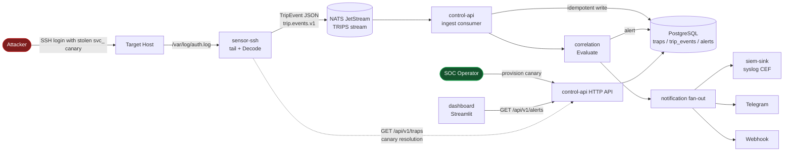

<div align="center">

# Göktürk Deception Mesh

**Air-Gapped, Zero-False-Positive Credential Canary Platform (Göktürk Platform P1)**

[](https://go.dev/)
[](https://nats.io/)
[](https://www.postgresql.org/)
[](https://streamlit.io/)
[](PROJECT%20PLAN.md)
[](https://github.com/GokturkFK)

*Plant a credential canary (honeytoken), detect attacker usage in ≤5 seconds with zero false positives, correlate campaigns automatically, and fan out to SOC & SIEM—all on a single air-gapped `docker compose up` stack.*

</div>

---

## Demo


*Captured on a live `docker compose up` stack: a credential canary is provisioned, a simulated SSH login triggers a **High** alert in ≤5 seconds, and a second attempt from the same source merges into a single **Critical** campaign alert.*

---

## Overview

**Göktürk Deception Mesh** is Pillar 1 (P1) of the Göktürk Security Platform. Its shared trap contract and deterministic correlation engine live in [`gokturk-core`](https://github.com/GokturkFK/gokturk-core), enabling seamless alert federation alongside [`gokkalkan`](https://github.com/GokturkFK/gokkalkan) (P2) and [`gokzincir`](https://github.com/GokturkFK/gokzincir) (P3).

**Zero-FP by Construction:** The correlation engine intentionally avoids ML anomaly scoring. Every alert stems strictly from a deterministic canary match (`Decode` → known `trap_id`):
- **1 trip** → `High` alert
- **≥2 trips from the same source** → merged into a single `Critical` campaign alert

Full threat model and framework mappings: [`docs/THREAT_MODEL.md`](docs/THREAT_MODEL.md) · Project plan & Definition of Done: [`PROJECT PLAN.md`](PROJECT%20PLAN.md).

---

## Architecture

A modular monolith (`control-api`: provisioning + ingestion + correlation + alerting + HTTP API in one binary) paired with a lightweight `sensor-ssh` agent over **NATS JetStream**:



### Components

| Component | Responsibility |
| :--- | :--- |
| **`sensor-ssh`** | Tails `auth.log`, runs `ParseAuthLine` → `Decode`; publishes `TripEvent` only for known canaries (`ErrNotATrip` drops all legitimate noise). |
| **`control-api`** | Trap provisioning HTTP API, `trip.events.v1` JetStream consumer, campaign correlation, PostgreSQL persistence, and alert fan-out. |
| **`nats`** | NATS JetStream event bus (`TRIPS` stream, `trip.events.v1` subject). |
| **`postgres`** | Durable storage for `traps`, `trip_events`, and `alerts`. |
| **`dashboard`** | Multi-source Streamlit SOC dashboard consuming `GET /api/v1/alerts` (configurable via `ALERT_SOURCES` to federate P1 + P2 + P3). |
| **`siem-sink`** | Reference Syslog CEF receiver for SIEM integration demos. |

---

## Getting Started

### Prerequisites

- **Go 1.25+**
- **Docker** & **Docker Compose v2+**

### Run the Full Stack

```sh
cp deployments/docker/.env.example deployments/docker/.env   # fill in credentials
make docker-up
```

Brings up all 6 services (`control-api`, `sensor-ssh`, `nats`, `postgres`, `dashboard`, `siem-sink`). See [`deployments/docker/docker-compose.yml`](deployments/docker/docker-compose.yml) for port and environment configuration.

### Development & Testing

```sh
make build
make test
make lint
```

---

## Göktürk Security Platform

| Pillar | Repository | Focus |
| :---: | :--- | :--- |
| **Core** | [**`gokturk-core`**](https://github.com/GokturkFK/gokturk-core) | Frozen `trap` wire contract & deterministic `correlate` engine |
| **P1** | **`gokturk-deception-mesh`** *(this repo)* | Credential canaries, SSH sensor, NATS JetStream & unified SOC dashboard |
| **P2** | [**`gokkalkan`**](https://github.com/GokturkFK/gokkalkan) | Agentic AI runtime security — MCP egress proxy & agent honeypot |
| **P3** | [**`gokzincir`**](https://github.com/GokturkFK/gokzincir) | Non-Human Identity (NHI) governance & blast-radius graph |

---

<div align="center">
  <sub>Developed by <a href="https://github.com/GokturkFK">GokturkFK</a> · <a href="CODEOWNERS">CODEOWNERS</a></sub>
</div>
