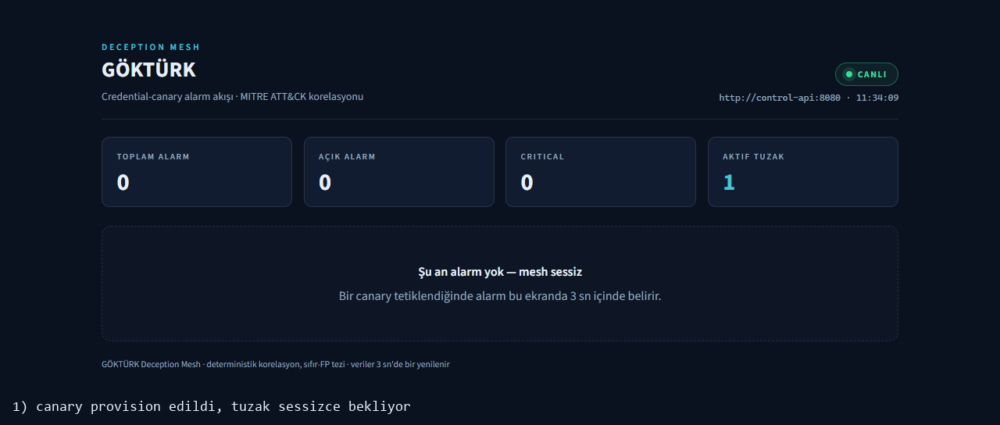

<div align="center">

# Göktürk Deception Mesh

**Air-Gapped, Sıfır Yanlış Pozitifli Kimlik Kanaryası Platformu (Göktürk Platform P1)**

[](https://go.dev/)
[](https://nats.io/)
[](https://www.postgresql.org/)
[](https://streamlit.io/)
[](PROJECT%20PLAN.md)
[](https://github.com/GokturkFK)

*Bir kimlik kanaryası (honeytoken) ekin; saldırgan onu kullandığı anda ≤5 saniye içinde sıfır yanlış pozitif ile yakalayın, kampanyaları otomatik birleştirin ve SOC/SIEM'e iletin — tamamı air-gapped tek bir `docker compose up` yığını üzerinde.*

**🇹🇷 Türkçe** · [🇬🇧 English](#-english)

</div>

---

## Demo



*Canlı `docker compose up` yığını üzerinden alınmıştır: bir kanarya provision edilir, sahte SSH girişi ≤5 saniyede **High** alarm üretir ve aynı kaynaktan ikinci deneme tek bir **Critical** kampanya alarmında birleşir.*

---

## Genel Bakış

**Göktürk Deception Mesh**, Göktürk Güvenlik Platformu'nun 1. sütunudur (P1). Paylaşılan tuzak sözleşmesi ve belirlenimci korelasyon motoru [`gokturk-core`](https://github.com/GokturkFK/gokturk-core) reposunda yaşar; bu sayede [`gokkalkan`](https://github.com/GokturkFK/gokkalkan) (P2) ve [`gokzincir`](https://github.com/GokturkFK/gokzincir) (P3) ile ortak bir SOC alarm akışı sağlar.

**Tasarımı Gereği Sıfır-FP:** Korelasyon motorunda bilinçli olarak ML/anomali skorlaması yoktur. Her alarm yalnızca kesin bir kanarya eşleşmesinden (`Decode` → bilinen `trap_id`) doğar:
- **1 tetiklenme** → `High` alarm
- **Aynı kaynaktan ≥2 tetiklenme** → tek bir `Critical` kampanya alarmı

Tehdit modeli ve çerçeve eşlemeleri: [`docs/THREAT_MODEL.md`](docs/THREAT_MODEL.md) · Proje planı ve DoD: [`PROJECT PLAN.md`](PROJECT%20PLAN.md).

---

## Mimari

Modüler monolit (`control-api`: provisioning + ingestion + korelasyon + alarm + HTTP API tek binary) ve hafif `sensor-ssh` ajanı **NATS JetStream** üzerinden haberleşir:

| Bileşen | Sorumluluk |
| :--- | :--- |
| **`sensor-ssh`** | `/var/log/auth.log` dosyasını izler, `ParseAuthLine` → `Decode` çalıştırır; yalnızca bilinen kanaryalar için `TripEvent` yayınlar (`ErrNotATrip` meşru trafiği sessizce düşürür). |
| **`control-api`** | Tuzak provisioning HTTP API'si, `trip.events.v1` JetStream tüketicisi, kampanya korelasyonu, PostgreSQL kaydı ve bildirim fan-out'u. |
| **`nats`** | NATS JetStream olay veriyolu (`TRIPS` stream, `trip.events.v1` subject). |
| **`postgres`** | `traps`, `trip_events` ve `alerts` tabloları. |
| **`dashboard`** | `GET /api/v1/alerts` ucunu izleyen çok kaynaklı Streamlit SOC paneli (`ALERT_SOURCES` ile P1 + P2 + P3 birleşik görünüm). |
| **`siem-sink`** | SIEM entegrasyon demoları için Syslog CEF alıcısı. |

---

## Hızlı Başlangıç

### Gereksinimler

- **Go 1.25+**
- **Docker** ve **Docker Compose v2+**

### Tüm Yığını Ayağa Kaldırma

```sh
cp deployments/docker/.env.example deployments/docker/.env   # değerleri doldurun
make docker-up
```

Altı servisin tamamını başlatır (`control-api`, `sensor-ssh`, `nats`, `postgres`, `dashboard`, `siem-sink`). Detay: [`deployments/docker/docker-compose.yml`](deployments/docker/docker-compose.yml).

- **SOC Paneli:** `http://localhost:8501` — `GET /api/v1/alerts` ucunu 3 saniyede bir sorgular.
- `sensor-ssh`, `/var/log/auth.log` dosyasını salt okunur bağlar (Debian/Ubuntu biçimi varsayılır).

### Panelde Birden Fazla Ürün (GKO-4)

Panel, aynı `Alert` sözleşmesini konuşan diğer Göktürk ürünlerinin alarmlarını kod değişikliği gerektirmeden tek akışta gösterir:

```sh
ALERT_SOURCES=GÖKTÜRK=http://control-api:8080,GÖKKALKAN=http://host.docker.internal:8090,GÖKZİNCİR=http://host.docker.internal:8100
```

### Demo Akışı (DoD)

```sh
# 1) Bir kanarya provision et ("username" svc_ ile başlar, "secret" tek sefer döner)
curl -s -XPOST http://localhost:8080/api/v1/traps \
  -H "Authorization: Bearer $OPERATOR_TOKEN" | tee /tmp/canary.json

# 2) Saldırgan simülasyonu: auth.log'a sahte SSH giriş satırı düşür
U=$(jq -r .username /tmp/canary.json)
logger -p auth.info "sshd[1]: Failed password for $U from 203.0.113.7 port 40012 ssh2"

# 3) ≤5 sn içinde panelde High alarm + siem-sink'te CEF kaydı
docker compose -f deployments/docker/docker-compose.yml logs siem-sink
```

Kanarya olmayan bir kullanıcıyla giriş → **hiçbir alarm üretmez** (sıfır-FP kanıtı).

### Otomatik Tuzak Dağıtımı & Air-Gapped Kurulum

- **Otomatik ekim (`cmd/seeder`):** Hedef sunucuya SSH üzerinden gerçekçi servis hesabı ve geriye tarihlenmiş ev dizini yerleştirir. Detay: [`docs/SEEDING.md`](docs/SEEDING.md).
- **Air-gapped kurulum:** `deployments/airgapped/build-bundle.sh` tüm servis imajlarını `docker save` ile tek arşive paketler; hedef makinedeki `install.sh` hiçbir `docker pull`/`build` yapmadan yığını ayağa kaldırır (CI'daki `airgapped-bundle` adımıyla doğrulanır). Adımlar: [`deployments/airgapped/README.md`](deployments/airgapped/README.md).

### Geliştirme, Test ve Migration

```sh
make build
make test
make lint
make migrate-up
make migrate-down
```

---

## Branch & PR Kuralları

`main` dalı korumalıdır: doğrudan push kapalıdır, tüm zorunlu CI kontrolleri (`Build, vet, test`, `golangci-lint`, Docker build + Trivy, Dashboard pytest) yeşil olmadan merge edilmez; yalnızca **squash** merge açıktır.

---

## Göktürk Güvenlik Platformu

| Katman | Depo | Odak |
| :---: | :--- | :--- |
| **Çekirdek** | [**`gokturk-core`**](https://github.com/GokturkFK/gokturk-core) | Dondurulmuş `trap` sözleşmesi & belirlenimci `correlate` motoru |
| **P1** | **`gokturk-deception-mesh`** *(bu depo)* | Kimlik kanaryaları, SSH sensörü, NATS JetStream & birleşik SOC paneli |
| **P2** | [**`gokkalkan`**](https://github.com/GokturkFK/gokkalkan) | Ajan tabanlı yapay zekâ güvenliği — MCP egress proxy & ajan honeypot |
| **P3** | [**`gokzincir`**](https://github.com/GokturkFK/gokzincir) | İnsan-olmayan kimlik (NHI) yönetişimi & blast-radius grafiği |

---

<a id="-english"></a>

<details>
<summary><b>🇬🇧 English</b> — click to expand</summary>

<br/>

## Overview

**Göktürk Deception Mesh** (Pillar 1 of the Göktürk Security Platform) is an air-gapped, zero-false-positive credential canary platform built on [`gokturk-core`](https://github.com/GokturkFK/gokturk-core), **NATS JetStream**, **PostgreSQL**, and a multi-source **Streamlit SOC dashboard**.

- **Zero-FP by construction:** Alerts originate exclusively from deterministic canary matches (`1 trip → High`, `≥2 trips from same source → Critical campaign`).
- **Components:** `sensor-ssh` (`auth.log` tailer/decoder), `control-api` (provisioning, ingestion, correlation, SIEM CEF / Telegram / Webhook fan-out), `nats`, `postgres`, `dashboard`, `siem-sink`.
- **Air-gapped delivery:** `deployments/airgapped/build-bundle.sh` bundles all container images for offline installation, continuously verified in CI.

## Quickstart

```sh
cp deployments/docker/.env.example deployments/docker/.env
make docker-up
```

See [`docs/THREAT_MODEL.md`](docs/THREAT_MODEL.md) and [`PROJECT PLAN.md`](PROJECT%20PLAN.md) for threat model and architecture details.

</details>

---

<div align="center">
  <sub><a href="https://github.com/GokturkFK">GokturkFK</a> tarafından geliştirilmektedir · <a href="CODEOWNERS">CODEOWNERS</a></sub>
</div>
